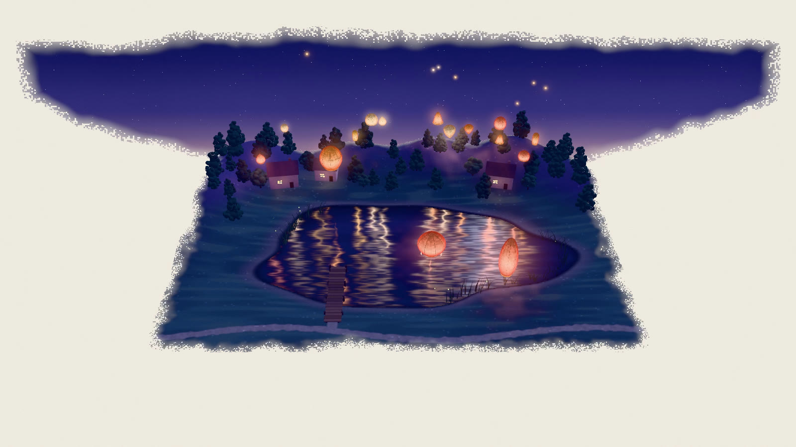
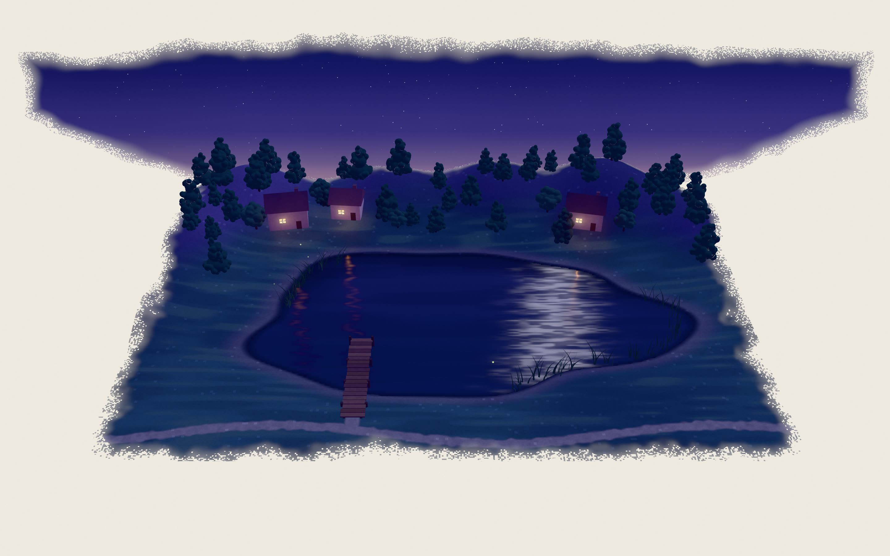
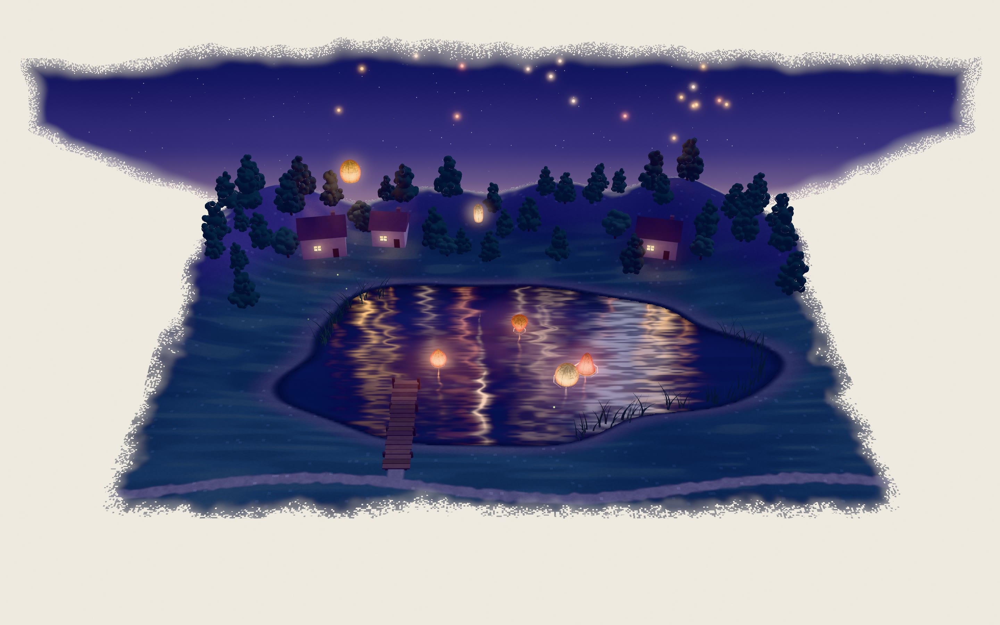
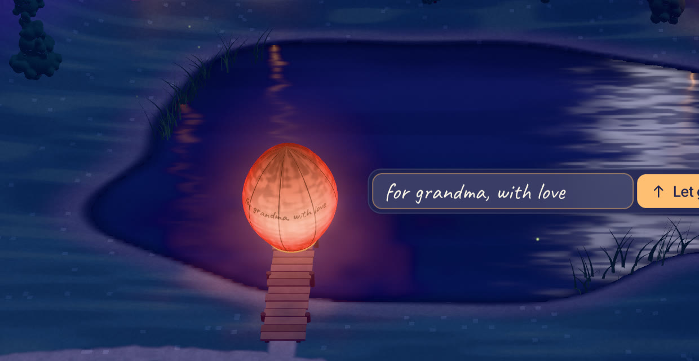
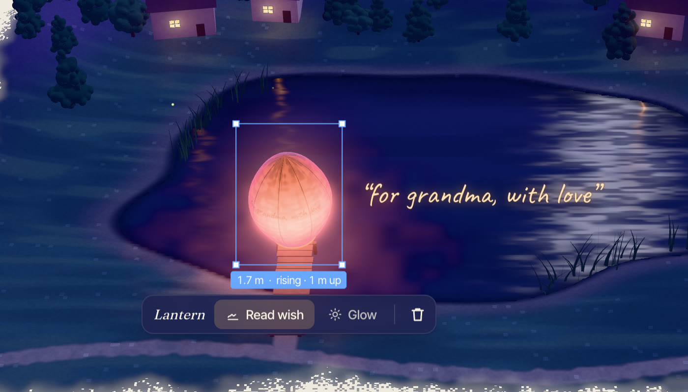

# LANTERNS

**Draw a lantern over a lake at dusk. It lights up, lifts off, and drifts up into the night.**



LANTERNS is the sixth piece in a family by the same hand — after [MEADOW](https://github.com/Mariaareadne1/meadow-interactive) (draw a sheep), POND, HIVE, [SKY](https://github.com/Mariaareadne1/sky-interactive) and TIDE — and its first night. One thing to draw, one thing it makes:

- **Draw a closed loop**, any shape, over the shore, the jetty or the sky. It becomes a paper sky lantern with *your* silhouette — tall, squat, heart-ish, lopsided — painted in with a brush, and its flame catches.
- **Make a wish** if you like (one line, written on the paper in a loose hand as you type), then **Let go**. Leave it alone and after about four seconds it lets itself go.
- It lifts slowly, then steadily, swaying on the breeze, its reflection following on the lake, and ends as a tiny warm star over the hills. Up to forty stay in the sky; the oldest fade as new ones go up.
- **Draw on the water** and it sits on a little folded-paper boat and sails slowly round the lake, lighting the water around it.
- **Tap a lantern** to *Read wish*, make it *Glow* (its neighbours brighten in answer), or *Remove* it (the flame goes out with a curl of smoke).

Demo (18 s, recorded by the app's own recorder): [`docs/media/lanterns-demo.mp4`](docs/media/lanterns-demo.mp4)

| | |
|---|---|
|  |  |
|  |  |

## Controls

| | |
|---|---|
| Draw a closed loop | A lantern (on the lake: a floating one) |
| Space | Let go of the lantern waiting on the ground |
| Click / tap a lantern | Select it: Read wish · Glow · Remove |
| Tab · Esc · Delete | Next lantern · deselect · remove |
| ⌘Z · ⇧⌘Z | Undo · redo |
| H | Hide the interface |

The menu has Showcase, Record 12-second clip (with the drawn line composited in), Hide interface, Export/Import scene and Clear the sky. The night is saved in the browser; reloading brings every lantern back where it is now — each one's position is a pure function of when it was let go.

## Running it

```bash
npm install
npm run dev          # http://localhost:5396
npm test             # 33 unit tests
npm run test:e2e     # 15 Playwright tests in real Chromium (Metal ANGLE)
E2E_PROD=1 npm run test:e2e   # the same against the production build
npm run build
```

QA scripts (with the dev server running): `node scripts/shoot.mjs <name> [query] [w] [h]`, `node scripts/draw.mjs <name> <x> <z> [round|tall|squat|heart] [px] [ms,…]`, `node scripts/wish.mjs`, `node scripts/perf.mjs [dpr]`, `node scripts/demo.mjs`, `node scripts/gallery.mjs`. URL flags: `?empty`, `?showcase`, `?quality=low`.

## How it's made

Vite + TypeScript + plain Three.js with custom `ShaderMaterial`s; React only for the interface. Everything is procedural — no textures, models or photos. See [`docs/ART_DIRECTION.md`](docs/ART_DIRECTION.md) for the night palette, [`CASE_STUDY.md`](CASE_STUDY.md) for the decisions and what went wrong, and [`docs/SIBLINGS.md`](docs/SIBLINGS.md) for what was adapted from the family.

MIT licensed.
